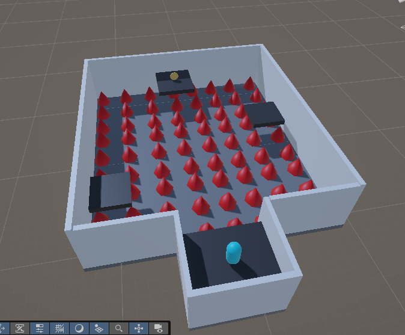
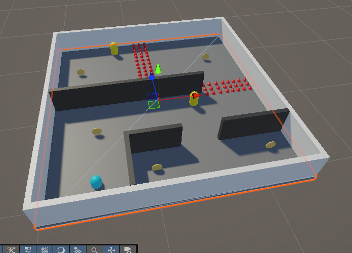
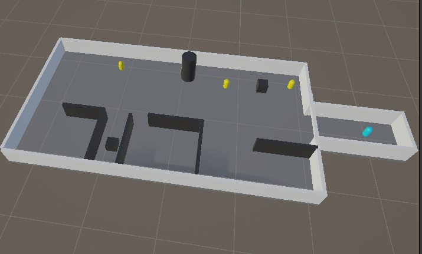
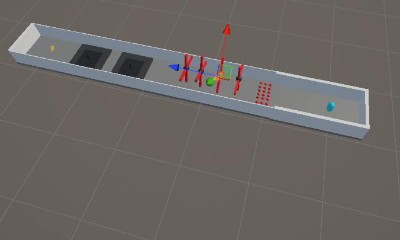
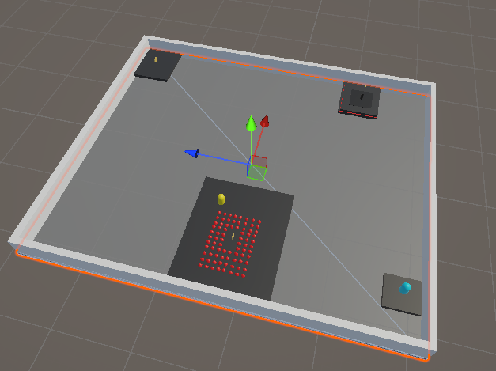

# CS464 Assignment 03 · Hafiz Azfar Umar Sheikh · BSSE23064

- **Video (60–120 s):** https://drive.google.com/file/d/1fEkQfAyUMOWN11LjkvBRQyUBwIrHrPxY/view?usp=drive_link
- **Started from:** New project, Reason: had to make new levels, and had to implement a lot of new mechanics, so it would be easier to start from scratch
- **Controls:** WASD to move (relative to the camera), Space to jump, mouse to orbit the camera.
- **To win a level:** Collect coins until the score on screen reaches its target (Score: x / y) without losing all your lives. Some levels lock the final coin until the others are collected.

## Levels

| Level   | Screenshot                              | New idea                    | Combined with                                                                                                                                     |
| ------- | --------------------------------------- | --------------------------- | ------------------------------------------------------------------------------------------------------------------------------------------------- |
| Level01 |  | Frogger style platforms     | the hazard scripts and enemypatrol scripts being re used for platforms                                                                            |
| Level02 |  | Collect all coins           | THe lecture level idea combined with the hazards and guards                                                                                       |
| Level03 |  | Avoid the guards            | Guards have a sight, so if they see you and detect you, you take damage                                                                           |
| Level04 |  | Survive the obstacle course | Combined the hazard script, and made rotating fans that can hurt the player                                                                       |
| Level05 |  | The floor is lava           | Used the hazard script on a box collider the same size as the floor, and a separate script that changed the colours of the floor when lava was on |

## The numbers

| Number            | Value                                                                    | Why this value                                                                                                                                                                                                                                                    |
| ----------------- | ------------------------------------------------------------------------ | ----------------------------------------------------------------------------------------------------------------------------------------------------------------------------------------------------------------------------------------------------------------- |
| Run speed         | 5 m/s                                                                    | Fast enough to cross a room in a few seconds, and faster than every guard, so a guard can always be outrun.                                                                                                                                                       |
| Patrol speed      | 2.6 m/s                                                                  | About half of the players run speed: slow enough to read a guard's route and slip past, fast enough to feel like a threat. Some guards have a faster speed to be difficult to navigate around.                                                                    |
| Chase range       | 7 (with 0.5 detection time)                                              | Adequate distance combined with the fast speed of these guards, increasing it might make it annoying instead of a challenge                                                                                                                                       |
| Knockback         | 6 (spikes) and 10 (guards), `ForceMode.Impulse`, steering off for 0.25 s | With mass 1 the push is 6 and 10 m/s, so about 1.5 m and 2.5 m over 0.25 s: far enough to clear the hazard, short enough to stay in control.                                                                                                                      |
| I-frames          | 2 s                                                                      | Long enough to make sure the player doesn't die in 1 hit, in case a hazard knocks the player into another hazard, the player has enough time to reposition, plus it is short enough considering the knockback that the player cannot abuse the i-frames to cheat. |
| Power-up duration | 5 s at ×1.6 speed                                                        | Just feels right for a suitable power up without feeling like a cheat code, you still have to control the player at the high speed and avoid the hazards. A second pickup restarts the timer.                                                                     |

## Short answers

**1. Why does a trigger need a Rigidbody on at least one of the two objects?**
An 'OnTrigger'event only occurs for a pair of colliders when at least one has a Rigidbody, two Rigidbody less colliders are treated as static and never generate events.
**2. Which ForceMode do your knockback and your Part A force use, and why each?**
ForceMode.Impulse, because thats makes sense for a one time knockback, impulse applies the whole force in one physics step and scales by mass.
**3. What does your code do when a second power-up is picked up while one is running?**
For Speed, 'PowerUp' calls 'BoostSpeed', which does 'if (boost != null) StopCoroutine(boost)' and starts a new coroutine. The old timer is cancelled, the multiplier is set again (1.6 → 1.6, not 2.56), and the duration restarts at 5 s, so it refreshes rather than stacks. For Shield, 'shielded = true' is a bool, so a second shield changes nothing.
**4. Why can `==` fail as an arrival check, and when does it work?**
Floats and positions moved by hand rarely land exactly on the target, so '==' can be skipped forever, the moving target if off by .0001 and it does not register as being on the specified position. In 'EnemyPatrol', 'transform.position == target' works because 'Vector3.MoveTowards' snaps exactly onto the target on the final step.
